# Hackathon Defense & Architecture: Problem Statement 09
## Trace Leaked Copies and Limit Offline Access
**Category:** DATA SECURITY | CRYPTOGRAPHY  
**Solution:** LeakLens (SentinelTrace Forensic Watermarking & Time-Bounded Offline DRM)

---

## 1. Problem Statement Deconstruction & LeakLens Solution

| Problem Statement Requirement | The Technical Vulnerability | The LeakLens Solution | How It Is Proven in Demo |
| :--- | :--- | :--- | :--- |
| **"When a sensitive file is encrypted once and decrypted by many recipients, identical decrypted copies cannot be traced to a person."** | 1-to-$N$ broadcast encryption yields identical plaintext bytes once decrypted. An insider can copy-paste text or screenshot memos with zero forensic attribution. | **Dynamic Zero-Width Steganographic Injection:** During generation (`/api/watermark`), LeakLens encodes recipient metadata (`recipient_id`) and session hashes into invisible Unicode zero-width characters (`\u200B`, `\u200C`, `\u200D`). Each recipient receives a forensically unique document. | **Tab 1 & Tab 2 Demo:** Generate watermarks for different recipients. Paste any excerpt into the Inspector (`/api/inspect`) to instantly reveal the exact leaker. |
| **"Produce visually identical copies with distinct forensic watermarks."** | Visible watermarks (stamps, backgrounds) deface documents and can be cropped, blurred, or removed with OCR. | **True Zero-Width Pixel Invisibility:** Zero-width spaces have a rendering width of $0\text{ px}$. The font rendering engine skips glyph layout entirely. Word counts, paragraph structures, and line breaks remain 100% identical. | **Visual Diff Inspection:** The generated memo in Tab 1 looks visually identical to raw text, yet contains an invisible binary stream. |
| **"A cryptographically verifiable match from a leaked copy to its recipient and session."** | Unsigned steganography can be tampered with or spoofed to frame innocent employees. | **HMAC-SHA256 Cryptographic Binding:** Before embedding, the engine signs `recipient_id \| session_id` using a tamper-proof secret key (`SECRET_KEY`). The inspector re-computes and matches the hash. If altered, verification fails. | **Integrity Check in Tab 2:** Shows `Signature Verified (HMAC-SHA256)` badge with 100% match, or alerts on key mismatch. |
| **"Offline devices cannot receive revocation updates."** | Push revocation (remote kill-switches, webhooks) fails as soon as an adversary unplugs their ethernet cable, disables Wi-Fi, or uses airplane mode. | **Cryptographic Lease Windows & Ephemeral Memory Shredding:** LeakLens replaces vulnerable *push revocation* with *time-bounded lease expiration*. Keys are granted with a strictly bounded TTL (1–120 min). When offline time expires, keys are auto-zeroed from memory. | **Tab 3 Live Telemetry:** Polls `/api/validate-lease` every 1s. Countdown reaches 0 $\rightarrow$ status immediately flips from `ACCESS GRANTED` to `ACCESS REVOKED / EXPIRED`. |

---

## 2. Technical Architecture & Cryptographic Workflow

```mermaid
flowchart TD
    subgraph Issuance["1. Issuance & Watermarking (/api/watermark)"]
        RawDoc["Plaintext Document"]
        Meta["Metadata: recipient_id + session_id"]
        HMAC_Gen["Compute HMAC-SHA256(SECRET_KEY, payload)"]
        BitEnc["Binary Modulation: 0 -> \\u200b, 1 -> \\u200c, Delim -> \\u200d"]
        WatermarkedDoc["Forensically Unique Document (0 px footprint)"]

        RawDoc --> WatermarkedDoc
        Meta --> HMAC_Gen
        HMAC_Gen --> BitEnc
        BitEnc --> WatermarkedDoc
    end

    subgraph Distribution["2. Offline DRM & Lease Enforcement (/api/validate-lease)"]
        KeyStore["Local Enclave Memory"]
        Timer["Monotonic Countdown: Permission Window"]
        StatusCheck{"Time Remaining > 0?"}
        AccessGranted["ACCESS GRANTED (Document Decrypted)"]
        AccessRevoked["ACCESS REVOKED (Memory Auto-Zeroed)"]

        KeyStore --> Timer
        Timer --> StatusCheck
        StatusCheck -- "Yes" --> AccessGranted
        StatusCheck -- "No (Time Expired / Offline)" --> AccessRevoked
    end

    subgraph Investigation["3. Forensic Leak Attribution (/api/inspect)"]
        LeakedSnippet["Leaked Text / Excerpt"]
        Filter["Extract Zero-Width Unicode Characters"]
        Demod["Demodulate Bits -> String"]
        SigVerify{"HMAC-SHA256 Matches Expected?"}
        AttributionCard["Leaker Revealed: recipient_id + session_id (Verified)"]
        TamperCard["Tamper Warning: Invalid Signature"]

        LeakedSnippet --> Filter
        Filter --> Demod
        Demod --> SigVerify
        SigVerify -- "Valid" --> AttributionCard
        SigVerify -- "Invalid / Spoofed" --> TamperCard
    end
```

---

## 3. Winning 3-Minute Presentation Pitch

### The Hook (`0:00 – 0:45`)
> *"When enterprises share confidential documents with 50 employees, a standard encrypted file looks identical to everyone. If a screenshot or snippet leaks on Reddit, traditional DRM is blind, and offline devices ignore revocation servers. We built **SentinelTrace (LeakLens)** to solve both."*

### The Core Live Demo (`0:45 – 2:00`)
1. **Step 1 — Visually Identical Copies**: Open **Tab 4 (Judge Stress Test)** and show the side-by-side copies generated for **Alice (`USR-8492`)** and **Bob (`USR-9014`)** — visually 100% identical ($0\text{ px}$ footprint), yet cryptographically distinct.
2. **Step 2 — "Try to Break It" + Real-Time Webhook Alert**: Let a judge delete a sentence, alter words, or keep just 1 sentence from Alice's copy, then click **Analyze & Prove Source**. Instantly reveal:
   - Green **`Signature Verified (HMAC-SHA256)`** attribution identifying `USR-8492 (Alice)`.
   - Real-time incident alert popup: `🚨 CRITICAL INCIDENT: Forensic match confirmed for Recipient USR-8492 (Alice) | Session SESS-2026-ALICE.`
3. **Step 3 — 10-Second Offline Lease Window & Anti-Clock-Tamper**: Switch to **Tab 3 (Offline DRM Monitor)**, trigger the **10-Sec Lease Window**, watch it lock down (`ACCESS REVOKED / EXPIRED`) on expiry, and show **Simulate Clock Rollback** failing instantly against monotonic token validation.

### The Technical Edge & Impact (`2:00 – 3:00`)
> *"Under the hood, SentinelTrace combines three enterprise defenses:*  
> 1. **Redundant Zero-Width Steganography:** Invisible Unicode bits (`\u200B`, `\u200C`, `\u200D`) repeated every paragraph and 12 words—surviving partial copy-pastes and word edits.  
> 2. **HMAC-SHA256 Cryptographic Signing:** Prevents attribution spoofing and verifies authenticity on both text excerpts and multimodal PDF exports (invisible vector layers + metadata via `pypdf`).  
> 3. **Anti-Clock-Tamper Monotonic Leases:** Replaces push revocation with signed hardware monotonic lease windows that resist offline system-clock rollbacks."*

---

## 4. Live Verification Checklist for Judges

1. **Judge Stress Test ("Try to Break It")**: Open **Tab 4**, delete a sentence or change words in Alice's copy, and click *Analyze & Prove Source* — attribution and webhook alert trigger immediately.
2. **Multimodal PDF Inspection**: Download a watermarked PDF in **Tab 1**, upload it in **Tab 2**, and verify both PDF metadata and invisible vector layer extraction.
3. **10-Second Offline DRM & Clock Rollback**: Open **Tab 3**, click *10-Sec Lease Window* to watch automatic lock-down, or click *Simulate Clock Rollback* to prove monotonic tamper defense.
